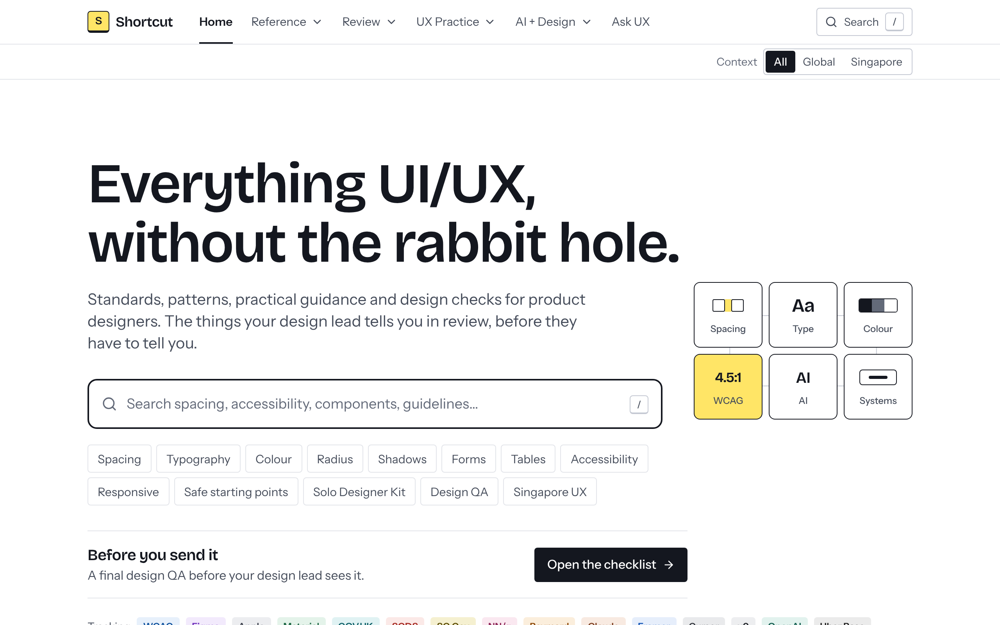
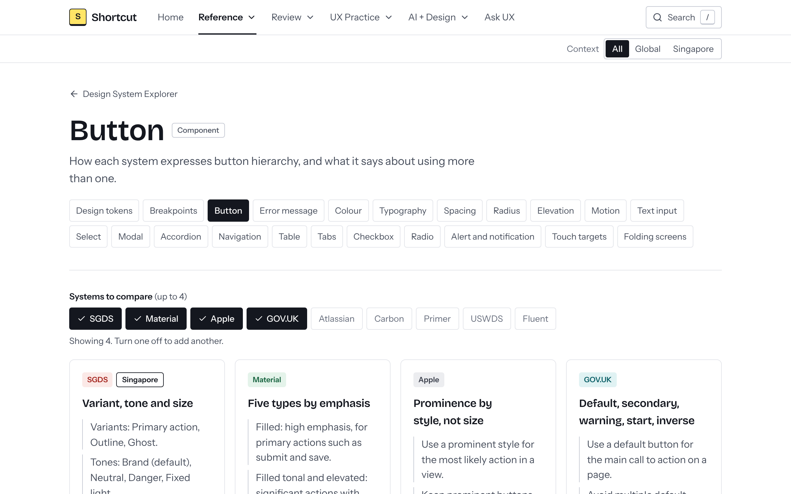
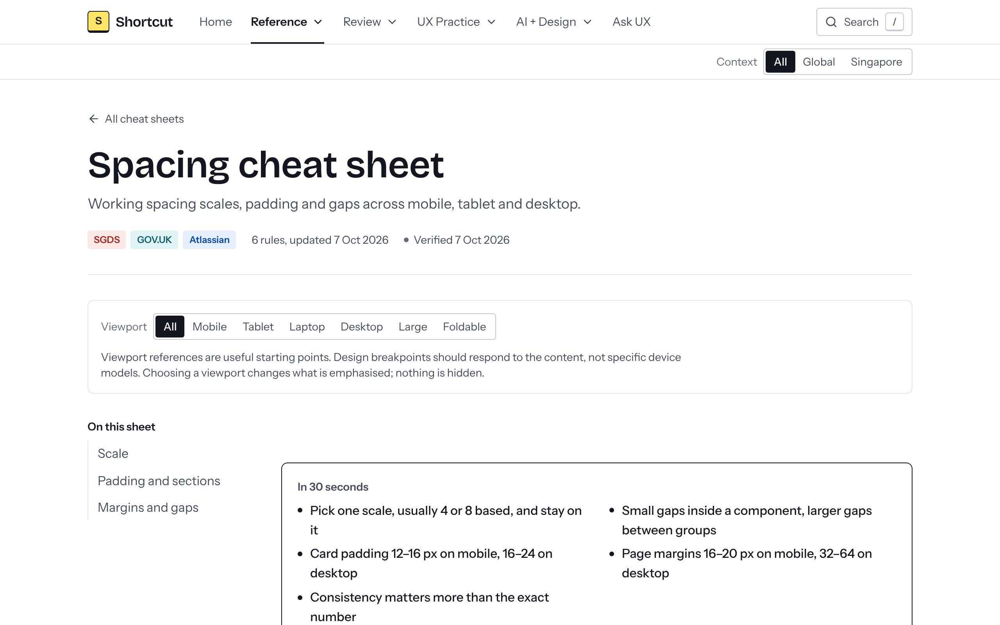
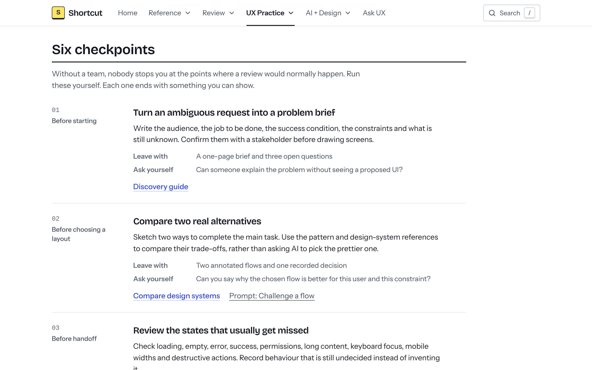

# Shortcut

**Everything UI/UX, without the rabbit hole.**

A practical reference library for product designers: cheat sheets, design system comparisons, design checks, UX practice guides and AI guidance, each one linked back to its source.

**[Visit Shortcut → meeyaow2.github.io/Shortcut-](https://meeyaow2.github.io/Shortcut-/)**



## Why I made it

I work as a sole UI/UX designer. On a normal week I might need to check a contrast requirement, see how three design systems handle the same component, plan a usability test and work out whether a new AI tool is worth trying, all without another designer nearby to ask.

The answers exist, but they are spread across standards, design system sites, articles and release notes. I kept losing time switching between tabs and re-finding the same things.

Shortcut is my attempt to bring that knowledge into one place and make it quick to apply: the answer first, the reasoning on request, and always a link to where it came from.

## What you can explore

**Reference**
- **Cheat sheets.** 35 quick references, from spacing, typography and colour to forms, tables, navigation and Figma. Every rule names its source, and a viewport control shows what matters most on mobile, tablet, desktop or foldable screens.
- **Design System Explorer.** See how SGDS, Material, Apple, GOV.UK, Atlassian, Carbon, Primer, USWDS and Fluent handle the same topic, up to four side by side, across 22 foundations and components.
- **Design System Library.** What each organisation actually publishes, with profiles of systems such as Material and Atlassian and product design references from companies like Grab.
- **Safe Starting Points.** Sensible values to begin from when no standard gives a hard answer, each saying what it depends on.
- **Figma Guide.** Which Figma tool to open for which job, and how they fit together.
- **Singapore UX.** Guidance for designing Singapore government digital services, with a Global / Singapore switch that filters cheat sheets, updates, search and Ask UX.

**Review**
- **Design Checks** to run on your own screen, the **Before You Send It** QA checklist, and **AI-Look Signals**: patterns that make an interface read as generated, and what to try instead.

**UX Practice**
- Guides for research, interviews, usability testing, workshops, critique and synthesis, with checklists, copyable templates and an Open Design Library of trusted free resources.
- **Solo Designer Kit.** Six checkpoints for carrying a product from brief to post-launch review on your own, with reusable review prompts.

**AI + Design**
- AI updates taken from each vendor's own release notes, a prompt library, AI tools organised by the job you are doing, a structured AI design review, and *Designing with Agents*, a nine-part learning track.

**Finding things**
- Site-wide search (press <kbd>/</kbd> or <kbd>Ctrl</kbd>/<kbd>⌘</kbd> <kbd>K</kbd>), and **Ask UX**, which matches a question to a set of written, sourced answers. Ask UX is not connected to an AI model, and says so when it has no answer.

<table>
  <tr>
    <td width="50%"></td>
    <td width="50%"></td>
  </tr>
  <tr>
    <td>Design System Explorer</td>
    <td>Spacing cheat sheet</td>
  </tr>
</table>

## Who it's for

- **Solo UI/UX designers** who need a second opinion and a quick way to check a decision.
- **Product designers** on small teams who want sourced answers they can share with engineers and stakeholders.
- **People learning UI/UX** who want to see what standards and design systems actually say, and where reasonable designers disagree.



## How sources and guidance are handled

Shortcut mixes two kinds of content and keeps them visibly apart:

- **Official references.** What a standard (such as WCAG), a government control, a design system or a vendor says. These link to the original page and show when Shortcut last checked them.
- **Editorial guidance.** Conventions, craft advice, workflows and prompts that I wrote. These are labelled "Industry convention" or "Craft guidance" with a review date, and are never shown as verified or as a requirement.

Each citation also carries a weight label, so a WCAG requirement, a design system's recommendation and a research article are never presented as equal. Shortcut summarises and links rather than reproducing other sites. Design system names, documentation and trademarks belong to their owners, and the original pages remain the authority.

If something is out of date or misattributed, please let me know (see Feedback below).

## Built with

- [Next.js](https://nextjs.org/) 16 (App Router) with React 19 and TypeScript
- [Tailwind CSS](https://tailwindcss.com/) v4 and [Lucide](https://lucide.dev/) icons
- A fully static export with no backend; search, filters and preferences run in the browser
- Hosted on GitHub Pages, deployed by GitHub Actions on every push to `main`

## Run it locally

You need [Node.js](https://nodejs.org/) 20.9 or newer.

```bash
git clone https://github.com/meeyaow2/Shortcut-.git
cd Shortcut-
npm install
npm run dev
```

Then open [http://localhost:3000/Shortcut-/](http://localhost:3000/Shortcut-/). The site uses the `/Shortcut-` path locally too, so links behave as they do on GitHub Pages.

`npm run build` writes the static site to `out/`. Project structure, the deployment workflow, static-export limits, content and sourcing rules, and design and accessibility conventions are in the [development guide](docs/development.md).

## Feedback

Shortcut is a personal portfolio project that I design and maintain on my own, so there is no formal contribution process. If you notice a broken link, an outdated source or an error, opening an issue is the most helpful thing you can do. Please open an issue before starting a pull request, so we can agree on the change first.

## Licence

No licence has been chosen for this repository yet. The code and content are viewable here, but they are not licensed for reuse. Please ask before copying or adapting them.
